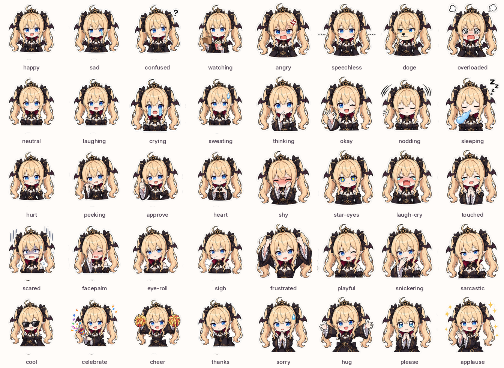

# cursor-grok-emoji

[English](README.en.md) | 简体中文

在 Cursor 的对话回复里，按情绪插入可更换的 Grok 娘表情。语义和 [dsh-emoji](https://github.com/hellodigua/dsh-emoji) 的 40 个 key 相同，其他表情包可以按同一份 `pack.json` 换进来。


角色是 Grok 娘的粉丝二创，不是 xAI 或 Cursor 的官方表情。

## 效果

模型在正常聊天的正文里插入 Markdown 图片，Cursor 把图片渲染出来。默认是全身贴纸，每张单独成段。



原图预览：

<details>
<summary>五张设定表</summary>


</details>

## 安装

需要 Node.js 18 或更新版本。装好后从下一条消息开始生效。

### 本机所有项目

```sh
git clone --depth 1 --branch v1.0.0 https://github.com/FYou87/cursor-grok-emoji.git
cd cursor-grok-emoji
node scripts/install.mjs --scope user
```

然后在 Cursor 里执行 **Developer: Reload Window**。插件位于 `~/.cursor/plugins/local/grok-emoji`。企业版如果关掉了本地插件导入，改用下面的项目规则或用户规则。

### 只在当前项目

把规则文件放进仓库即可，不需要把 40 张图复制进来：

```sh
mkdir -p .cursor/rules
curl -fsSL -o .cursor/rules/grok-emoji.mdc \
  https://raw.githubusercontent.com/FYou87/cursor-grok-emoji/v1.0.0/plugin/rules/grok-emoji.mdc
```

克隆了本仓库时，根目录已经带有 `.cursor/rules/grok-emoji.mdc`。

### 粘贴到用户规则

用户规则会跟着 Cursor 账号同步。在 Customize → Rules 里新建一条，内容用：

```sh
node scripts/install.mjs --scope paste
```

设置页会把 frontmatter 当成普通文字。保留即可，真正起作用的是正文里的 `frequency` 行和 key 列表。

### 从 GitHub 添加插件

在 Customize 里选择从 GitHub 仓库添加，填 `https://github.com/FYou87/cursor-grok-emoji`。仓库根目录有 `.cursor-plugin/marketplace.json`。安装范围选用户或当前项目。

## 频率

规则开头有一行：

```text
frequency: smart
```

| 值 | 行为 |
| --- | --- |
| `off` | 不使用这套表情 |
| `smart` | 只在确实有助于表达时使用，每回合最多 3 张。默认 |
| `frequent` | 每段对话回复都放一张贴合情绪的图，每回合最多 4 张 |

改法任选其一：

```sh
node scripts/install.mjs --scope user --frequency frequent
node scripts/install.mjs --scope project --frequency off
```

装了插件之后，也可以在对话里运行 `/grok-emoji-frequency`，或者说“把表情调成高频”。当前这条消息已经读过旧规则，频率从下一条消息起变化。

`extra:` 那一行可以写一句附加偏好，例如更少使用 `sarcastic`。它不能提高张数上限，也不能增加 key。

## 图片为什么这样出现

dsh-emoji 让模型输出 `😊`，再由 DeepSeek Harness 换成表情包图片。Cursor 的回复钩子不能改写已经显示的消息，所以这里让模型直接写：

```markdown

```

Cursor 对话允许渲染 `https` 图片。图片需要能访问 `raw.githubusercontent.com`。本地文件只有放在当前工作区里、并且用绝对路径时才稳定：Unix 为 `/绝对/路径/happy.png`，Windows 为 `/C:/绝对/路径/happy.png`。

这套素材是 256×256 的全身贴纸，小到 1.5em 会看不清，因此 `pack.json` 声明 `displayMode: block`，每张图单独成段。表情不会写进代码块、命令、diff、提交说明或落到磁盘上的文件。

## 换成自己的表情包

准备一个目录或 ZIP。可以直接放文件，也可以外面再包一层目录：

```text
my-pack/
├── pack.json
└── images/
    ├── happy.png
    ├── sad.png
    └── …其余 38 个 key
```

`pack.json`：

```json
{
  "schemaVersion": 1,
  "keySet": "dsh-emoji-core@1",
  "id": "my-pack",
  "name": "我的表情",
  "version": "1.0.0",
  "displayMode": "block"
}
```

`displayMode` 可省略，省略时按行内理解。每个 key 恰好一张同名 PNG，边长不超过 512。含义和容易混淆的边界见 [EMOJI_KEYS.md](EMOJI_KEYS.md)。

```sh
node scripts/validate.mjs ./my-pack
node scripts/validate.mjs ./my-pack.zip
```

图片已经放在某个 https 目录时：

```sh
node scripts/install.mjs --scope project \
  --image-base https://example.com/my-pack/images \
  --pack ./my-pack
```

`--pack` 用来读取 `id`、`version` 和 `displayMode`。只在本机当前项目里用、不打算提交图片时：

```sh
node scripts/install.mjs --scope project --pack ./my-pack
```

这会把 PNG 复制到 `.cursor/grok-emoji/<id>/images/`，规则里写成这台电脑的绝对路径。换机器或给同事用时，改回 https。

Grok 娘这套包本身就是合法的自定义包，ZIP 里只有 `pack.json` 和 `images/*.png`，可以拿去 dsh-emoji 的“上传 ZIP”。发布页附有 `grok-pack-1.0.0.zip`。

## 开发

```sh
node --test
node scripts/validate.mjs
node scripts/build-release.mjs
```

从白底原图重新导出透明 PNG、横幅和总览图：

```sh
python3 scripts/prepare_assets.py --zip /path/to/grok-emoji-images.zip
node scripts/render-rules.mjs
```

## 致谢

语义契约、频率和 `pack.json` 格式来自 [hellodigua/dsh-emoji](https://github.com/hellodigua/dsh-emoji)，该项目以 MIT 许可发布。

Grok 娘形象为粉丝二创。本仓库不表示与 xAI、Cursor 或原作者存在官方关系。

## 许可

[MIT](LICENSE)。使用和再分发代码、规则与这份表情包时，请保留版权声明。
